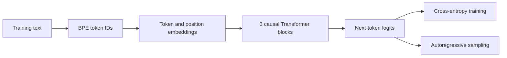

# Mini GPT from scratch

A laptop-scale experiment in next-token prediction. This repository implements causal attention,
Transformer blocks and autoregressive generation in PyTorch, and trains a byte-level BPE tokenizer
using Hugging Face Tokenizers. The released 32-token model comes with matching weights and tokenizer.

## Run the released model

From a clean checkout with Python 3.11:

```sh
python3 -m venv .venv
source .venv/bin/activate
python -m pip install -r requirements.txt
python generate_bpe.py --checkpoint demo/model.pt --tokenizer demo/tokenizer.json --prompt "ROMEO:" --temperature 0.8 --top-k 40 --tokens 80
python -m unittest discover -s tests
```



## Results

The initial 64-token model achieved test perplexity **69.29** on 19,724 Tiny Shakespeare predictions,
compared with **96.33** for a smoothed bigram model. An earlier exploratory validation run included
that test text. [Evaluation data](results/test-metrics.json)

We then trained 32- and 64-token models at equal token budgets (819,200 targets each).
Across seeds 42, 43 and 44, the lowest mean full-validation loss selected **32 tokens**.
The demo uses the preselected seed 42. Times cover training, sampled evaluations, generation and checkpoint writes on one Mac CPU, and can vary with machine load.

| Context | Mean validation loss ± sample SD | Mean seconds/run | Mean training targets/s |
| ---: | ---: | ---: | ---: |
| 32 | 4.0043 ± 0.0121 | 54.6 | 16,963 |
| 64 | 4.0599 ± 0.0128 | 59.5 | 15,431 |

The 32-token runs used 16 sequences per batch and the 64-token runs used 8. The smaller position
table and the frequency of context resets also differ. [Six individual runs](results/windows.json)

On the separately reserved *Shakespeare’s Sonnets*, the selected model scored **91.48**
perplexity across 33,646 predictions. Bigram scored **116.14**
and unigram **460.91** on those same targets. Poetry is a genre shift from the training plays.
[External scores](results/sonnets.json) · [Corpus source](https://github.com/GITenberg/Shakespeare-s-Sonnets_1041)

## Generation performance

Projecting only the final hidden state to the vocabulary produced **499 tokens/s**
versus **434 tokens/s** for the full projection (1.15×).
A batch of one used a full context and 128 greedy steps, four CPU threads, two warm-up pairs and
ten alternating timed pairs. We checked matching greedy IDs and final-position logits within
tolerance. [Individual timings](results/benchmark.json)

## Where the model struggles

The earlier 64-token checkpoint repeatedly generated “There is the king” under greedy decoding.
The small corpus and next-token objective yield recognizable dialogue structure alongside repetition
and invented words. [Released model sample](results/sample.txt)

[Reproduce training, selection and evaluations](docs/reproduce.md) · [Three-minute demo](docs/demo.md) · [Verified package versions](results/environment-macos-arm64.txt)
